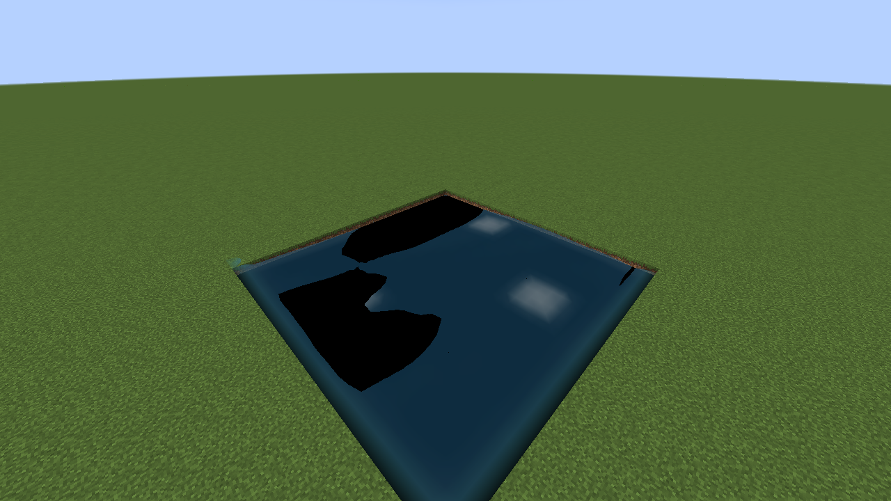
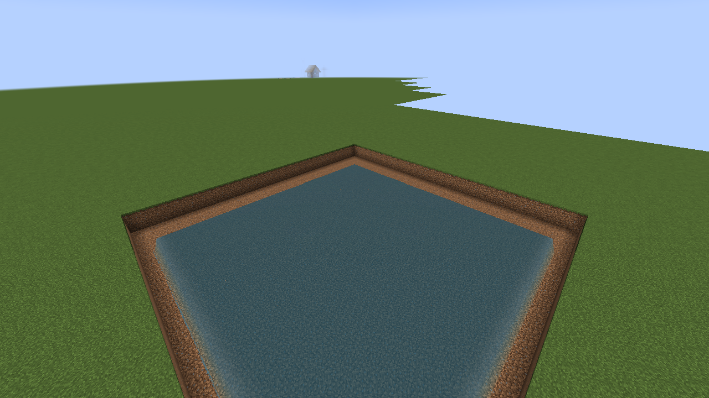
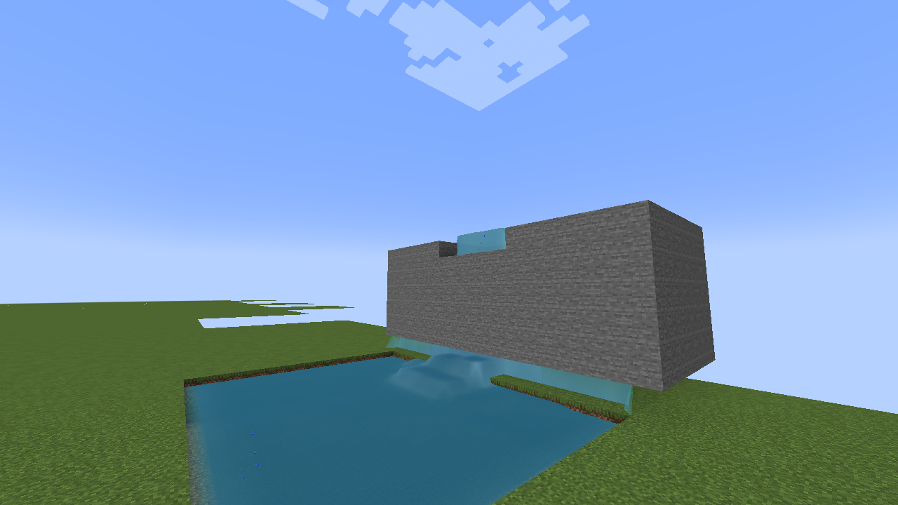
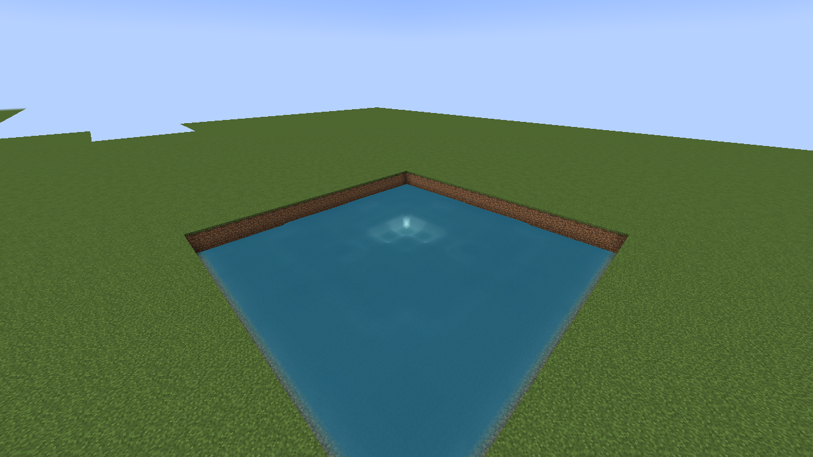
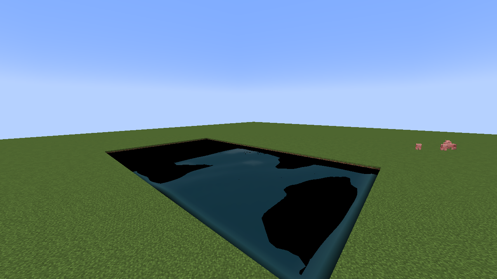
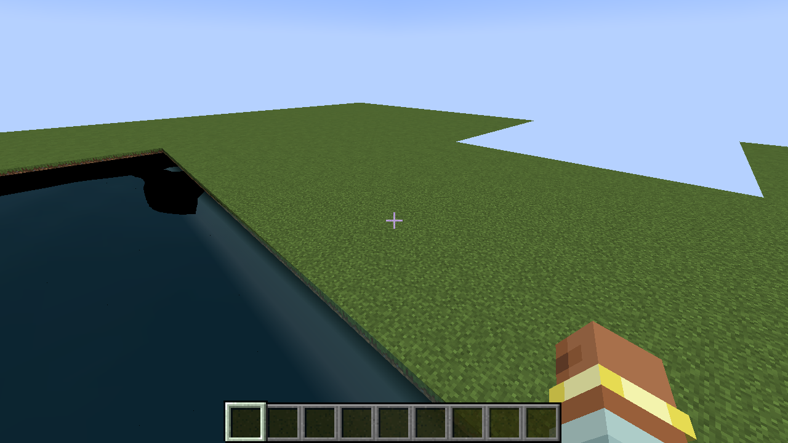
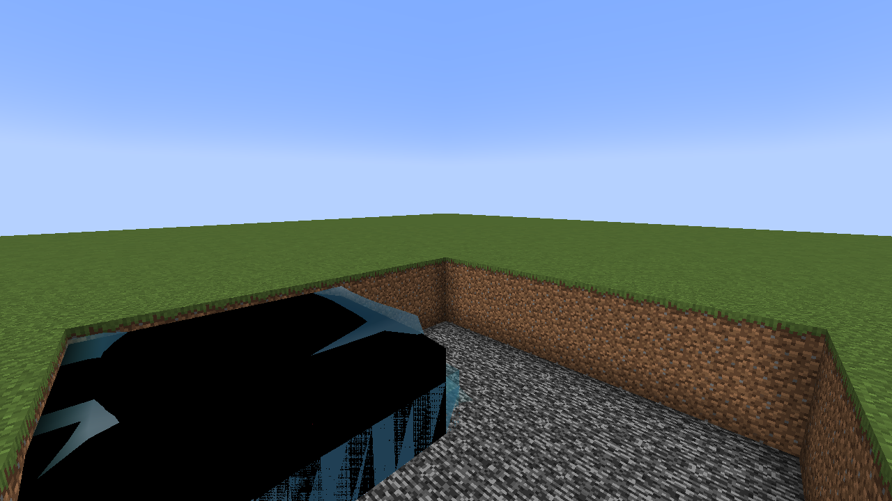
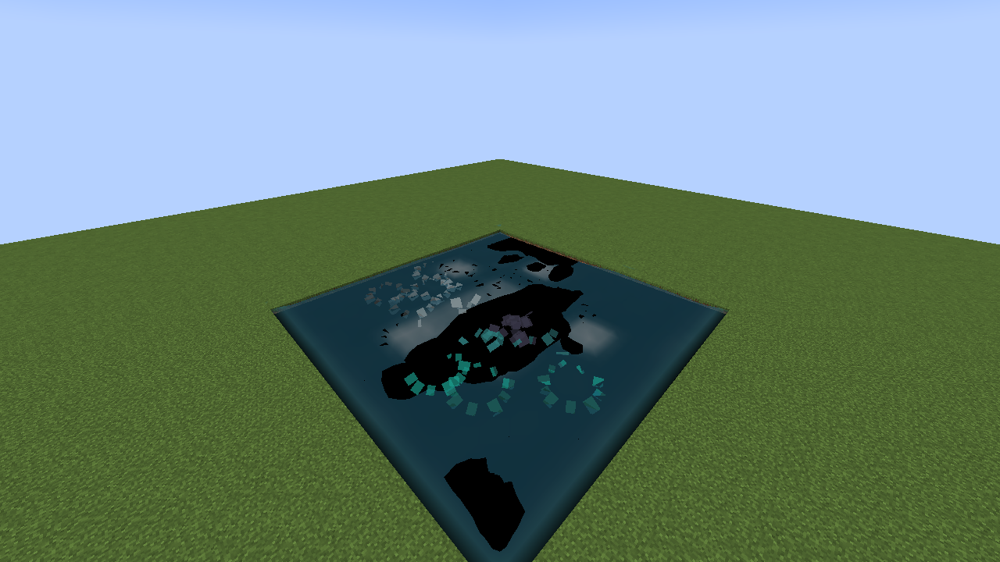

# Aquaflux — физическая вода для Forge 1.20.1

[](https://github.com/standimaoff-oss/NEWwoorld/actions/workflows/build.yml)

Мод заменяет «бесконечную» ванильную воду на **конечную массу**, которая реально течёт:
яма наполняется, реку можно вычерпать, поверхность гладкая, а не из кубов.

> **Статус: 0.3.0 — вода с весом, пеной и водопадами.** Физика, гладкая поверхность, капли
> и слив с уступов работают; полная замена ванильной воды по всему миру (океаны, дождь,
> аквиферы) пока в разработке — см. «Ограничения».

---

## Превью — кадры из игры

Это **настоящие скриншоты из Minecraft 1.20.1 с модом**: CI поднимает виртуальный экран
(Xvfb) с программным OpenGL, запускает клиент, строит сцены в мире и снимает кадр прямо из
кадрового буфера (`src/main/java/com/standimaoff/aquaflux/dev/GameScreenshots.java`).
Никаких оффлайн-рендеров: то, что на картинке, — это то, что видит игрок.
Кадры пересобираются воркфлоу `In-game screenshots` и лежат в `docs/preview/ingame/`.

| | |
|---|---|
|  |  |
| **Яма** — вылили воду в котлован, она встала уровнем; кромка гладкая, без кубов | **Озеро** — 29×29 блоков, отражение неба на скользящих углах, тёмная толща |
|  |  |
| **Водопад** — вода уходит с утёса через кромку в чашу под ним; кадр снят, пока струя ещё идёт | **Взрыв** — удар в центр пруда: провал, кольцо волн и брызги |
|  |  |
| **След пловца** — 14 ударов по воде подряд: кольца и пена | **Интерфейс** — тот же кадр с HUD, чтобы было видно: это игра |

| | |
|---|---|
|  |  |
| **Крупный план** — три всплеска: капли-билборды в воздухе и пена на поверхности | **Дождь по воде** — 42 удара по поверхности, круги и брызги |

Кадры 1280×720, собираются автоматически; в артефактах прогона лежит ещё и `jar`.

---

## Известные ограничения

- Воду озёр и котлованов рисует гладкий меш по пакету с сервера; «физические» блоки
  ставятся только там, где толща глубже двух блоков. Тонкую воду (плёнка, лужа) блоков
  не получает: ванильный рендер жидкости не умеет быть полностью невидимым и на тонкой
  воде вылезает чёрной полосой, поэтому там остаётся только меш.
- Отладочные переключатели (`DEBUG_MODE` в `SurfaceMesh`, `-Daquaflux.fillall`,
  `-Daquaflux.magenta`, `-Daquaflux.tint`) оставлены в коде для диагностики и по
  умолчанию выключены.

---

## Что уже умеет

| Возможность | Как это выглядит в игре |
|---|---|
| **Конечная масса** | Вода не размножается из двух источников. Сколько налил — столько и есть. |
| **Течение** | Настоящий решатель мелкой воды: давление от разницы уровней, трение о дно, инерция. |
| **Ямы и котлованы** | Выкопал яму — вода стекает в неё. Вылил ведро — оно утекает и растекается. |
| **Осушение** | Небольшую реку можно вычерпать вёдрами: масса уходит, уровень падает. |
| **Гладкая поверхность** | Не кубы: сетка высот, сглаженные углы, нормали по градиенту, пена у берега. |
| **Волны от игрока** | Слабые круги и след за игроком/лодкой в воде. Сила настраивается. |
| **Сущности на волнах** | Игроки, мобы и лодки качаются на поверхности, а не висят в воде. |
| **Взрывы** | Взрыв в воде — расходящееся кольцо волн, брызги, пузыри и много пены. |
| **Пресеты 16/32/64** | Точность физики (Q8.8 / float / double) **и** битность текстуры. Задаются отдельно. |
| **Своё ведро** | `Ведро физической воды` — отдельный предмет, ванильная вода рядом не тронута. |
| **Замена ванили** | Один ключ в конфиге: постепенно превращает ванильные источники рядом с игроком. |
| **Iris / Oculus / OptiFine** | Автоопределение всех трёх; шейдеры есть — вода уходит в общий прозрачный проход. |
| **Производительность** | Активная зона вокруг игроков, бюджет регионов на тик, сон спокойной воды. |

---

## Установка

1. Minecraft **1.20.1**, Forge **47.x**.
2. Скачать **[aquaflux-0.3.0.jar](https://github.com/standimaoff-oss/NEWwoorld/releases/latest)**.
3. Положить в `mods/`. Мод нужен **и на клиенте, и на сервере** (в одиночной игре — просто в `mods`).

Зависимостей нет. OptiFine/Iris не обязательны.

---

## Как пользоваться

### Отдельное ведро (по умолчанию)

Ванильная вода остаётся ванильной. Физическая живёт сама:

1. Скрафтить ведро нельзя — возьмите `Ведро физической воды` во вкладке **Aquaflux** (или `/give @s aquaflux:physical_water_bucket`).
2. Вылейте в яму, на склон, в русло — вода потечёт по-настоящему.
3. Вёдрами можно черпать обратно: масса реально уменьшается.

### Полная замена ванильной воды

`config/aquaflux-common.toml`:

```toml
[world]
    replaceVanillaWater = true
    convertPerTick = 64
```

Мод начнёт превращать ванильные источники рядом с игроками в физическую воду (мягко, по
64 блока за тик). Новые чанки обрабатываются по мере приближения.

### Пресеты точности

`aquaflux-common.toml` — физика:

```toml
[physics]
    precision = "BITS32"   # BITS16 | BITS32 | BITS64
    cellSize = 0.5         # 1.0 грубо / 0.5 обычно / 0.25 точно
```

`aquaflux-client.toml` — картинка:

```toml
[surface]
    texturePrecision = "BITS32"   # 16 — 5-6-5, 32 — RGBA8, 64 — расширенный тон
    smooth = true
    radius = 20
```

| Пресет | Физика | Текстура | Кому |
|---|---|---|---|
| **16 бит** | Q8.8, шаг 1/256 блока, быстро засыпает | 5-6-5, заметные ступени | слабые ПК, большие серверы |
| **32 бита** | float, по умолчанию | RGBA8 | обычная игра |
| **64 бита** | double, без округления | расширенный тон | скриншоты, кино |

### Волны

```toml
[waves]
    fromEntities = true
    strength = 0.45   # 0 — нет, 1 — заметная рябь, 2 — шторм
```

---

## Конфиги целиком

**`aquaflux-common.toml`** — физика и мир:

| Ключ | По умолчанию | Что делает |
|---|---|---|
| `physics.enabled` | `true` | Включить симуляцию |
| `physics.precision` | `BITS32` | Точность решателя |
| `physics.cellSize` | `0.5` | Размер ячейки, блоков |
| `physics.gravity` | `9.81` | Гравитация, м/с² |
| `physics.bedFriction` | `0.12` | Трение о дно |
| `physics.maxDepth` | `32.0` | Предел глубины в ячейке |
| `world.replaceVanillaWater` | `false` | Полная замена ванильной воды |
| `world.convertPerTick` | `64` | Скорость замены |
| `world.activeRadius` | `48` | Радиус симуляции вокруг игрока |
| `world.regionSize` | `32` | Сторона региона |
| `world.regionsPerTick` | `4` | Бюджет TPS |
| `waves.fromEntities` | `true` | Волны от игроков и лодок |
| `waves.strength` | `0.45` | Сила волн |

**`aquaflux-client.toml`** — только вид:

| Ключ | По умолчанию | Что делает |
|---|---|---|
| `surface.smooth` | `true` | Гладкая поверхность вместо кубов |
| `surface.radius` | `20` | Радиус построения меша |
| `surface.rebuildInterval` | `3` | Перестройка каждые N кадров |
| `surface.texturePrecision` | `BITS32` | Битность текстуры |
| `surface.visualStrength` | `1.0` | Множитель видимости волн |
| `compat.shaderMode` | `AUTO` | `AUTO` / `FORCE_SMOOTH` / `VANILLA` |
| `compat.debug` | `false` | Отладочная строка |

---

## Совместимость

- **Без шейдеров** — свой слой прозрачности, ванильные лайтмапы и туман.
- **Iris / OptiFine с шейдерами** — мод определяет это сам (`AUTO`); поверхность рисуется
  ванильным прозрачным типом, который шейдерпак умеет обрабатывать.
- **`VANILLA`** — полностью отключить свой меш, вода будет как блоки (на случай конфликтов).
- Мод не патчит классы игры миксинами: только Forge-события и собственные блок/жидкость.

---

## Ограничения 0.3.0

Честно, чтобы не было сюрпризов:

1. **Только поверхностная вода.** Решатель работает по карте высот: пещеры, затопленные
   шахты и вода под крышей пока не симулируются.
2. **Швы регионов.** Соседние регионы обмениваются массой через край, но при резком напоре
   на границе возможны мелкие артефакты.
3. **Замена ванили постепенная.** Океаны не пересчитываются целиком: мод трогает только то,
   что рядом с игроком.
4. **Плавание** использует ванильную физику полного блока — вода «держится» как вода, но
   вертикальный профиль ещё не наклонный.
5. **Волны** — визуальные (плюс лёгкий импульс течению), а не полноценная волновая динамика.

Дальше по плану — см. [docs/ROADMAP.md](docs/ROADMAP.md).

---

## Сборка

Нужен JDK 17. Всё остальное подтянет Gradle Wrapper:

```bash
./gradlew build        # build/libs/aquaflux-<version>.jar
./gradlew test         # тесты ядра, без Minecraft
./gradlew runClient    # запуск клиента с модом
```

Ядро (`com.standimaoff.aquaflux.core`) не зависит от Minecraft, поэтому тесты идут за секунды.

Подробнее — [docs/BUILDING.md](docs/BUILDING.md), архитектура — [docs/ARCHITECTURE.md](docs/ARCHITECTURE.md).

---

## Лицензия

MIT. См. [LICENSE](LICENSE).

---

## English summary

**Aquaflux** replaces Minecraft's infinite water with a finite-mass, shallow-water simulation for
Forge 1.20.1: dig a hole and water flows in, drain a small river with buckets, smooth non-cubic
surface, player waves, 16/32/64-bit physics *and* texture presets, separate bucket by default with
an opt-in full vanilla replacement, automatic Iris/OptiFine cooperation. No mixins, no dependencies.
Current build is a surface-water prototype; see limitations above.
