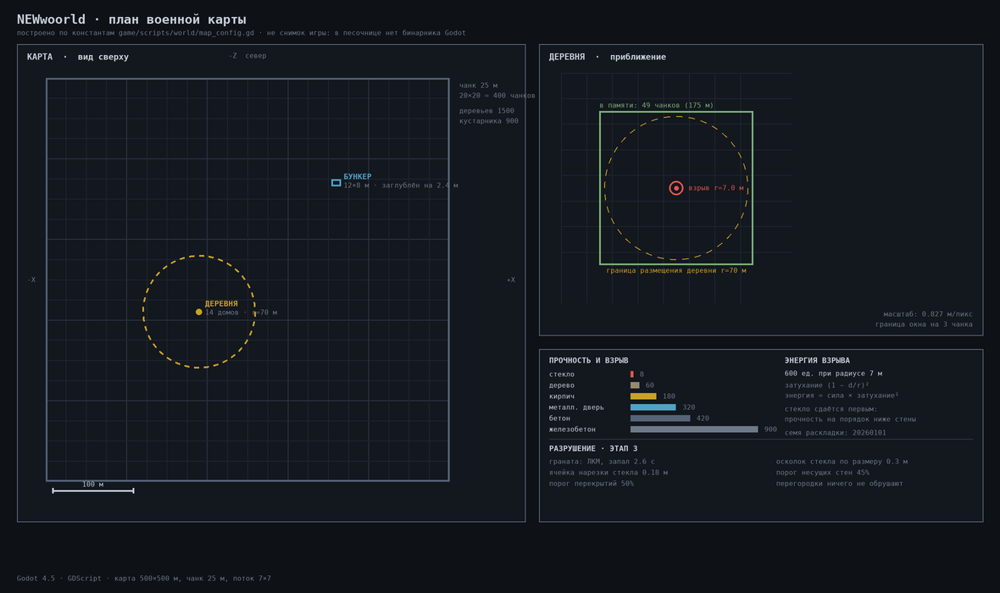

# Как запустить игру и тесты

Инструкция для запуска **на своей машине**. В песочнице разработки бинарника
Godot нет и быть не может: загрузка файлов релизов GitHub
(`objects.githubusercontent.com`) там заблокирована, поэтому игра собирается и
проверяется статически, а запускается у вас.

Все ссылки ниже проверены на доступность на момент написания.

---

## 1. Скачать исходники

Прямая ссылка на архив рабочей ветки (**1,6 МБ**, 437 файлов):

<https://github.com/standimaoff-oss/NEWwoorld/archive/refs/heads/arena/25517fbb-newwoorld.zip>

Или клонировать:

```bash
git clone --branch arena/25517fbb-newwoorld \
  https://github.com/standimaoff-oss/NEWwoorld.git
```

Страница ветки: <https://github.com/standimaoff-oss/NEWwoorld/tree/arena/25517fbb-newwoorld>

**Что есть в архиве.** `game/project.godot`, все сцены и скрипты, вендоренный
тестовый фреймворк GUT 9.6.1 (263 файла) — тесты работают сразу, без
установки зависимостей.

**Чего в архиве нет.** Подмодуль `gdextension/godot-cpp` (в zip попадает
только указатель на коммит). Он нужен исключительно для сборки C++-расширения;
**для запуска игры и тестов не требуется**. Если понадобится расширение —
клонируйте репозиторий с `--recursive`.

---

## 2. Скачать Godot

Проект собран под **Godot 4.5** (`compatibility_minimum = "4.5"`). Работает и
на более новых версиях 4.x — расширение собрано под старейшую поддерживаемую,
а ABI GDExtension обратно совместимо.

### Godot 4.5 (рекомендовано, ровно та версия, что в CI)

| Платформа | Прямая ссылка | Размер |
| --- | --- | --- |
| Windows 64-bit | <https://github.com/godotengine/godot/releases/download/4.5-stable/Godot_v4.5-stable_win64.exe.zip> | 72,6 МБ |
| Linux x86_64 | <https://github.com/godotengine/godot/releases/download/4.5-stable/Godot_v4.5-stable_linux.x86_64.zip> | 65,8 МБ |
| macOS (Intel + Apple Silicon) | <https://github.com/godotengine/godot/releases/download/4.5-stable/Godot_v4.5-stable_macos.universal.zip> | 152,2 МБ |

### Godot 4.7.2 (самая свежая стабильная 4.x)

| Платформа | Прямая ссылка | Размер |
| --- | --- | --- |
| Windows 64-bit | <https://github.com/godotengine/godot/releases/download/4.7.2-stable/Godot_v4.7.2-stable_win64.exe.zip> | 82,0 МБ |
| Linux x86_64 | <https://github.com/godotengine/godot/releases/download/4.7.2-stable/Godot_v4.7.2-stable_linux.x86_64.zip> | 74,3 МБ |
| macOS (Intel + Apple Silicon) | <https://github.com/godotengine/godot/releases/download/4.7.2-stable/Godot_v4.7.2-stable_macos.universal.zip> | 162,7 МБ |

Страница всех выпусков: <https://github.com/godotengine/godot/releases>

**Установка не нужна.** Это один исполняемый файл в архиве: распакуйте и
запускайте. Версии с `.NET`/`mono` в названии не нужны — проект на чистом
GDScript.

---

## 3. Запустить тестовую сцену карты

**`game/scenes/game/military_map.tscn` — это и есть готовая тестовая сцена
этапов 1–2.** В ней уже есть игрок, HUD, оверлей отладки и меню паузы, а
свойства `start_poi = 0` и `spawn_at_start_poi = true` ставят игрока **прямо у
деревенского дома** — интерьер виден сразу, без прохождения меню и без поиска
точки на 500 метрах.

### Через Makefile

```bash
# один раз: окружение для проверок (Python venv + gdtoolkit)
make setup

# указать, где лежит Godot, если его нет в PATH
export GODOT_BIN=/путь/до/Godot_v4.5-stable_linux.x86_64

make godot-import   # первый запуск: импорт ресурсов (один раз)
make run-map        # карта напрямую, минуя меню  ← ГЛАВНАЯ ЦЕЛЬ
make run            # игра с главного меню
make run-editor     # открыть проект в редакторе
```

### Вручную, без Makefile

```bash
# импорт ресурсов — один раз, обязательно до первого запуска
/path/to/Godot --headless --path game --import --quit

# тестовая сцена карты
/path/to/Godot --path game res://scenes/game/military_map.tscn
```

### В редакторе

1. Открыть Godot → **Import** → выбрать `game/project.godot`.
2. В списке сцен дважды щёлкнуть `scenes/game/military_map.tscn`.
3. Нажать **F6** (Run Current Scene) — запустится именно карта, а не меню.
   **F5** запускает главную сцену `boot.tscn` (меню).

---

## 4. Что смотреть и какие клавиши

Клавиши взяты из `game/project.godot`, раздел `[input]` (32 действия), а не
написаны от руки. Всё продублировано на геймпад, кроме отладочных.

| Клавиша | Действие |
| --- | --- |
| `W A S D` | движение |
| `Space` | прыжок |
| `Shift` | бег |
| `Ctrl` | присесть |
| `E` | взаимодействие: открыть/закрыть дверь |
| `ЛКМ` | бросок гранаты (`primary_action`): запал 2,6 с, радиус 7 м |
| `F10` | телепорт к деревенскому дому (точка интереса 1) |
| `F11` | телепорт к бункеру (точка интереса 2) |
| `F3` | оверлей отладки: FPS, узлы, физика, бюджет потока |
| `F4` | каркасный режим (wireframe) |
| `F6` | отладка физики в мире |
| `F12` | **скриншот** — см. раздел 6 |
| `F5` / `F9` | быстрое сохранение / загрузка |
| `Tab` | инвентарь, `M` — карта |
| `Esc` | меню паузы |
| `` ` `` | консоль отладки |

⚠️ `F6` в **редакторе** означает «запустить текущую сцену», а **в игре** —
отладку физики. Это разные контексты, конфликта нет, но совпадение цифр
сбивает с толку.

**Дом в деревне.** Два этажа: внизу горница с печью, столом и стульями,
сверху спальня с кроватью; между этажами лестница отдельными ступенями.
Снаружи крыльцо, труба, цоколь, ставни. Крыша — двускатная призма.

**Бункер.** Заглублён на 2,4 м, поэтому снаружи видны только выступающая
часть, вентиляционная труба и взрывная дверь. Внутри три помещения: зал со
столом с картой и двухъярусными койками, тамбур и склад с ящиками и бочками.
Взрывная дверь **заперта** — подсказка скажет «Взрывная дверь: открыть засов».
Внутри работают источники света: небесное освещение под землю не доходит.

Стёкла полупрозрачные и не отбрасывают тень; двери открываются нажатием `E`;
ветер качает растительность.

---

## 5. Запустить тесты

Тестов **17 файлов**: модульные, интеграционные и смоук. GUT уже лежит в
`game/addons/gut/`, скачивать ничего не нужно.

```bash
make test              # все тесты
make test-smoke        # только загрузка сцен, скриптов, ресурсов
make test-unit         # только модульные
make test-integration  # только интеграционные
```

Без Makefile:

```bash
/path/to/Godot --headless --path game -s addons/gut/gut_cmdln.gd \
  -gconfig=res://.gutconfig.json -gexit
```

Ожидаемый итог — строка без `Failing` с ненулевым числом.

---

## 6. Сделать скриншот

**Скриншот встроен в игру: клавиша `F12`.** Отдельный режим фото не нужен.

`Diagnostics.capture_screenshot()` берёт текстуру вьюпорта, пишет PNG и
логирует абсолютный путь сохранения — его видно в оверлее отладки (`F3`) и в
файле журнала. Файлы ложатся в `user://`, что на диске означает:

| ОС | Каталог |
| --- | --- |
| Windows | `%APPDATA%\Godot\app_userdata\NEWwoorld\` |
| Linux | `~/.local/share/godot/app_userdata/NEWwoorld/` |
| macOS | `~/Library/Application Support/Godot/app_userdata/NEWwoorld/` |

Имя файла — `shot_<метка времени>.png`.

### Что можно увидеть без запуска игры

Песочница рисует **схему карты** из настоящих констант исходника —
`docs/images/map_schematic.png`:



Это чертёж, а не снимок рендера: вид сверху на 500×500 м с сеткой чанков,
обеими точками интереса, окном стриминга и радиусом взрыва в масштабе карты.
Все числа читаются из `game/scripts/world/map_config.gd` и файлов этапа 3,
поэтому схема не может отстать от кода. Перерисовать: `make viz-map`.

### Почему скриншотов нет в этой песочнице

Разработка идёт в изолированной среде **без графического вывода и без
бинарника Godot**: загрузка файлов релизов GitHub там заблокирована на уровне
сети (`objects.githubusercontent.com` недоступен). Рендерить нечем и нечего,
поэтому кадры из игры физически не могут появиться из песочницы — их можно
сделать только на вашей машине, одной клавишей.

Всё, что в песочнице проверяется реально: синтаксис и стиль всех скриптов,
существование каждого обращения к API движка по `extension_api.json` от
Godot 4.5, арность и типы вызовов, структура сцен и ресурсов против того же
API, синтаксис шейдеров, компиляция C++ до объектных файлов, контракт
GDScript ↔ C++, гигиена репозитория. Это 8 шагов `verify_all.sh --strict`.

---

## 7. Проверки, которые работают без Godot

Их можно гонять где угодно, бинарник не нужен:

```bash
make verify    # 8 проверок целостности
make lint      # 5 стадий: синтаксис, формат, стиль, API движка, вызовы
make strict    # то же, но предупреждения считаются ошибками
make cpp       # C++-расширение до объектных файлов
```

---

## 8. Чего пока нет

Честно о состоянии, чтобы ожидания совпали с реальностью:

- **Разрушение не подключено** — это этап 3. `DestructionService` и шейдер
  растворения существуют и покрыты тестами, но взрывы, разлёт осколков стекла
  и падение деревьев ещё не связаны с картой. Стрельба по стенам пока ничего
  не разрушает.
- **Модели процедурные**, не `.glb`. Вся геометрия строится кодом из
  примитивов: ни одного внешнего ассета в проекте нет, каталог `game/assets/`
  пуст. Конвейер оптимизации `.glb` собран и проверен, но применять его пока
  не к чему.
- **Персонажей нет** — только контроллер от первого лица.
- **Звука нет** — аудиоканалы настроены, файлов нет.
- **Контакты в титрах — заглушки** `hello@example.com` и `https://example.com`
  в `game/data/credits.json`. Их нужно заменить до релиза.

Полный список требований и статус по этапам — раздел 13 в `ТЗ.md`.

---

## Связанные документы

- [`README.md`](../README.md) — что это за проект
- [`ARCHITECTURE.md`](ARCHITECTURE.md) — слои, цепочка модулей карты
- [`TESTING.md`](TESTING.md) — как устроены тесты
- [`VERIFICATION.md`](VERIFICATION.md) — что проверяют 8 шагов
- [`TROUBLESHOOTING.md`](TROUBLESHOOTING.md) — каталог симптомов и решений
