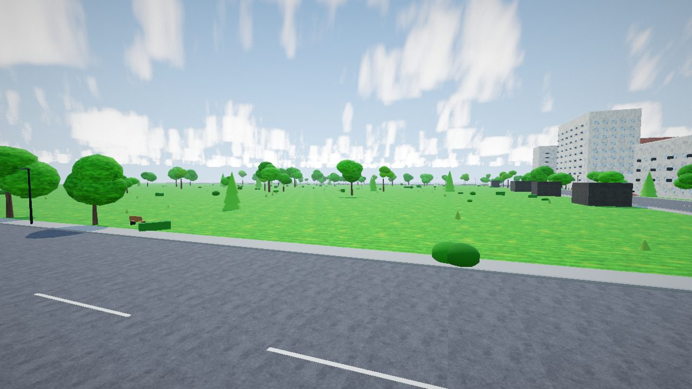
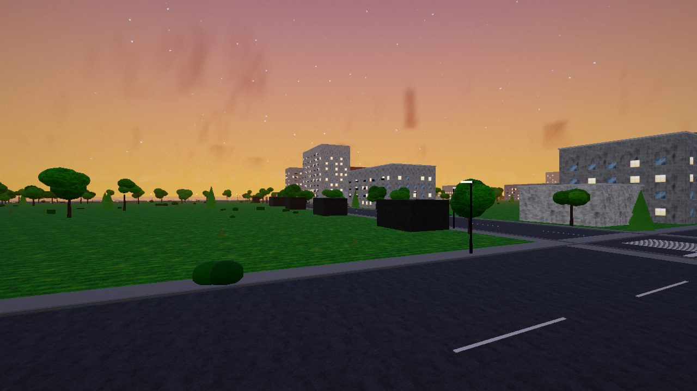

# ShopSim — открытый мир, магазины, вода и трава в реальном времени

Новая версия игры на **three.js / WebGL2**: один и тот же код запускается и на **Windows PC**, и на **Android**. Открытый город, магазины с витринами, покупатели, касса, товар на полках, трафик, смена дня и ночи, погода, сезоны.

```
SHOPSIM READY v0.6.0 {"buildings":466,"shops":60,"trees":1991,"bamboo":843}
```



Закат — тёплая заря, звёзды и подсвеченные окна:



*Улица в центре: застройка, газоны, деревья, кустарники и объёмные облака.*

---

## Быстрый запуск

### Windows

1. Распакуйте папку `game` целиком.
2. Двойной клик по **`ShopSim-Windows.bat`** (нужен Python — в Windows 10/11 обычно есть) или по **`ShopSim-Windows.ps1`** (PowerShell, без Python).
3. Откроется браузер с игрой.

Скрипт поднимает локальный сервер на `http://127.0.0.1:8123` и открывает страницу. Сервер нужен потому, что игра — ES-модули, а браузеры не грузят их по `file://`.

### Android

1. Скопируйте папку `game` на телефон **или** разместите её на любом веб-сервере (или GitHub Pages).
2. Откройте `index.html` в **Chrome** (лучше всего) или Firefox.
3. Для установки как приложения: меню Chrome → **«Добавить на главный экран»** / «Установить приложение».

Игра рассчитана на альбомную ориентацию, в полноэкранном режиме скрывает адресную строку.

### Установка как приложение (PWA)

Игра — полноценная **PWA**: её можно поставить на рабочий стол Windows и на главный экран Android, и она работает офлайн (service worker кэширует все модули).

- **Windows / Chrome / Edge**: значок установки в адресной строке → «Установить ShopSim». Появится ярлык в меню «Пуск», отдельное окно без адресной строки.
- **Android / Chrome**: меню ⋮ → «Установить приложение» / «Добавить на главный экран».

Иконки и манифест: `game/manifest.webmanifest`, `game/icons/`, `game/sw.js`.

### Честно про EXE и APK

Собрать **настоящие** `.exe` (Electron) и `.apk` (Capacitor/Cordova) в текущем окружении невозможно: сборка Electron требует скачать ~100 МБ бинарников с `github.com/electron/...`, а APK — Android SDK; сеть окружения эти хосты блокирует. Поэтому поставляется то, что реально работает без сборки:

| Платформа | Что поставляется | Как ставится |
|---|---|---|
| Windows 10/11 | `ShopSim-Windows.bat` / `.ps1` + PWA | двойной клик; либо «Установить» в Chrome/Edge |
| Android 7+ | та же папка `game` + PWA | открыть в Chrome; «Добавить на главный экран» |

Если нужен именно `.exe`/`.apk` — см. раздел «Как собрать EXE/APK» ниже: команды готовы, их надо запустить на машине с интернетом.

---

## Управление

| Действие | Windows | Android |
|---|---|---|
| Ходьба | W A S D | левый стик (появляется под пальцем) |
| Обзор | мышь | правая половина экрана |
| Бег | Shift | кнопка «Бег» |
| Взаимодействие / войти в магазин | E | кнопка «Действие» |
| Карта | M | кнопка «Карта» |
| Каталог товаров | B | кнопка «Каталог» |
| Пауза / настройки | Esc | кнопка «☰» |
| Заказ товара | 5 за клик, Shift — 20 | кнопки +/− в каталоге |

---

## Что есть в игре

**Мир.** 1600×1600 м, 466 домов, 60 магазинов 12 типов (продукты, киоск, пекарня, цветы, техника, одежда, кофейня, аптека, шаурма, книги, спорт, игрушки), 1991 дерево, 843 ствола бамбука, река и озеро с анимированной водой, набережная, площадь, парк с бамбуком, пляж с пальмами.

**Экономика.** Аренда и покупка помещений (от 95 000 ₽), товар заказывается партиями, раскладывается по полкам, покупатели ходят по залу, берут товар, стоят у кассы и платят. Выручка в реальном времени, репутация, ежедневная аренда, покупка оборудования (стеллажи, холодильник, касса, корзинки, светильник, вывеска).

**Погода.** Ясно / облачно / дождь / гроза / туман / снег. Дождь — 7000 капель в кубе 60×26×60 м вокруг камеры, брызги на земле, мокрые материалы, пасмурное серое небо, вспышки молний в грозу. Переходы идут по настенному времени и не зависят от FPS.

**Графика.**
- Трава: instanced, 22 стебля/м², чанки 16 м, ветер, сезонная окраска (лето/осень/зима), примятость под игроком, туман по краю радиуса.
- Вода: волны Герстнера + отражения по нормалям, рябь от капель дождя, пена у берега, разные цвета для реки/озера/моря.
- Облака: объёмный ray-marching по процедурному fbm внутри шейдера неба — кучевые, с подсветкой снизу и холодной тенью, без UV-швов. Покрытие зависит от погоды.
- Небо: градиент, солнце, луна, звёзды, ночное затемнение; облака не перекрывают дома.
- Материалы: PBR (MeshStandardMaterial), окружение (env map), ACES-тонмаппинг, sRGB, FXAA, HDR-пайплайн.
- Город: инстансинг всей застройки (тела домов по стилям, окна, балконы, карнизы, крышные надстройки, двери), витрины магазинов со светящимся стеклом и вывесками, козырьки, коврики.
- Трафик: 26 машин, фары и стоп-сигналы включаются ночью и в дождь.
- Погода: ясно / облачно / дождь / гроза / туман / снег, время суток 0–24.

**Управление производительностью.** Всё статичное — InstancedMesh с пространственной нарезкой по 240–340 м (чтобы работало отсечение по камере); растительность дополнительно отсекается по дистанции 400 м; трава — чанками вокруг игрока. Настройки качества (низкое/среднее/высокое) меняют плотность травы, тени, дальность.

---

## Параметры в адресной строке

| Параметр | Значение |
|---|---|
| `?hour=17.5` | время суток (0–24) |
| `?weather=rain` | `clear`, `cloudy`, `rain`, `storm`, `fog`, `snow` |
| `?season=autumn` | `summer`, `autumn`, `winter` |
| `?quality=low` | `low`, `medium`, `high` |
| `?spawn=x,y,z,yaw` | точка появления |
| `?fresh=1` | не загружать сохранение |
| `?newgame=1` | новая игра |
| `?nohud=1` | без интерфейса (для скриншотов) |
| `?panel=map` | сразу открыть панель |

## Отладка

В консоли браузера доступны `window.__game` и `window.__api`:

```js
__api.stats()        // fps, draw calls, треугольники, трава, время
__api.world()        // количество домов, магазинов, деревьев
__api.clouds()       // состояние облаков
__api.setHour(21)    // время
__api.setWeather('rain')
__api.shopList()
__api.teleport(26, 110)
```

---

## Разработка

```
game/
  index.html            точка входа, importmap
  styles.css            HUD и панели
  manifest.webmanifest  PWA
  sw.js                 service worker (офлайн)
  icons/                иконки приложения
  vendor/               three.js 0.187 (локально, без CDN)
  src/
    core/               настройки, ввод, интерфейс, звук
    util/               геометрия, логирование
    gfx/                рендерер, постобработка, текстуры, трава, вода, небо, эффекты
    world/              генерация мира, погода, город, трафик
    player/             камера и движение
    game/               магазины, геймплей
    test/               автотесты
  tools/                локальный сервер, скриншоты, автотест геймплея
```

Запуск локально:

```bash
# любой статический сервер, например:
python3 -m http.server 8123 --directory game
# или
node game/tools/serve.cjs 8123
```

Автотест (нужен Chromium; в CI — puppeteer):

```bash
node game/tools/gametest.cjs      # 13 проверок: мир, магазин, покупатели, деньги, сохранение
node game/tools/shots.cjs config.json 1280 720   # серия скриншотов
```

### Как собрать EXE/APK на машине с интернетом

```bash
# Windows EXE (Electron)
npm i -D electron electron-builder
npx electron-builder --win nsis --config.files="game/**/*" --config.directories.output=dist
# Android APK (Capacitor)
npm i @capacitor/core @capacitor/cli @capacitor/android
npx cap init ShopSim com.shopsim.game --web-dir=game
npx cap add android && npx cap sync android
cd android && ./gradlew assembleDebug
```

Обе команды требуют скачать бинарные зависимости (Electron-дистрибутив / Android SDK), поэтому в песочнице без доступа к их хостам не выполняются.

---

## Лицензии

three.js — MIT. Сторонние ассеты и ссылки на референсы — см. [../LICENSES.md](../LICENSES.md).
